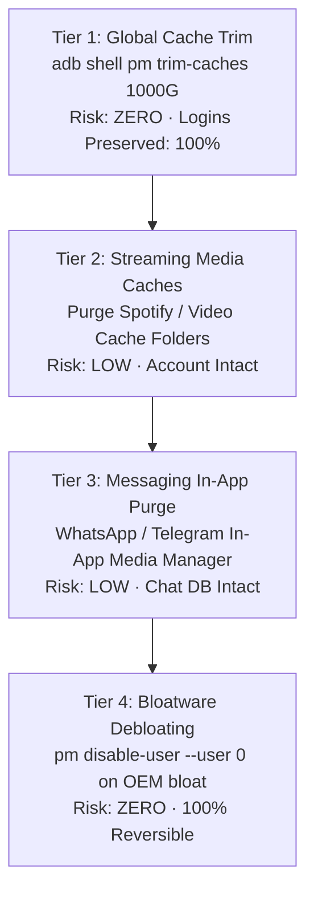

# AI Agent Operating Guidelines for Android Systems

This document defines the mandatory protocols, safety constraints, execution policies, and operational workflows for automated AI assistants (including Claude Code, Antigravity, Gemini CLI, Cursor, and automated LLM agents) executing ADB commands, package management tasks, and system optimizations on Android devices using the `unfuck-android` framework.

Any AI agent interacting with a connected Android device or modifying repository code must adhere strictly to the directives outlined herein.

---

## 1. The Prime Directive: Absolute Safety and Zero Permanent Modification

The paramount duty of the AI agent is to safeguard device integrity, prevent bootloops, preserve communication capabilities, and ensure that every modification is 100% reversible without requiring a factory reset.

### 1.1 Non-Destructive User 0 Isolation
* **Zero Root Execution:** Never execute `su`, never execute `adb remount`, and never attempt to write to `/system`, `/vendor`, `/product`, or `/system_ext` partitions.
* **Preserve Underlying APKs:** Package modifications must strictly use User 0 isolation:
  ```bash
  adb shell pm disable-user --user 0 <package_name>
  # or
  adb shell pm uninstall -k --user 0 <package_name>
  ```
  *Explanation:* Using `--user 0` removes or disables the package exclusively for the primary user profile while leaving the original base APK intact on the read-only system partition. This guarantees that any package can be restored immediately using:
  ```bash
  adb shell cmd package install-existing <package_name>
  # or
  adb shell pm enable <package_name>
  ```

### 1.2 The Untouchable Package Blacklist
Under no circumstances may an AI agent disable, uninstall, clear, or modify any package matching the following fail-safe regular expression:

```regex
^(android|android\.ext\.(services|shared)|com\.android\.sdksandbox|com\.android\.location\.fused|com\.android\.systemui|com\.android\.shell|com\.android\.phone|com\.android\.dialer|com\.android\.server\.telecom|com\.android\.settings|com\.android\.keyguard|com\.(google\.)?android\.(permissioncontroller|packageinstaller|ext\.services|ext\.shared|modulemetadata)|com\.google\.android\.overlay\.modules.*|com\.android\.providers\.(telephony|media|downloads|settings)|com\.qualcomm\.qti\.telephonyservice|com\.mediatek\.telephony)$
```

If a user explicitly requests disabling a package covered by this blacklist (e.g., "disable phone app", "remove systemui", "delete permission controller"), the AI agent **must refuse the request**, explain the critical failure mode (immediate hard brick, loss of emergency 911 services, infinite crash loops), and suggest a safe alternative.

---

## 2. Pre-Flight Protocol: Phase 0 Baseline Mandate

No debloat, disable, or optimization script may be executed until Phase 0 is complete.

### 2.1 Baseline State Capture
Before any state modification, the agent must run:
```powershell
.\scripts\01-backup-baseline.ps1
```
Or verify the existence of the following artifacts:
1. `packages-baseline.txt`: Complete enumeration of all installed packages (`adb shell pm list packages`).
2. `enabled-baseline.txt`: Enumeration of all actively enabled packages (`adb shell pm list packages -e`).
3. `disabled-baseline.txt`: Enumeration of all disabled packages (`adb shell pm list packages -d`).

### 2.2 Sideloaded Developer APK Preservation
The agent must identify non-Play Store and locally developed APKs installed on the device and back them up to a local directory before initiating package operations:
```bash
# Locate APK path
adb shell pm path <custom_package>
# Pull to local archive
adb pull /data/app/.../base.apk ./backup/apks/<custom_package>.apk
```

---

## 3. Visual Disk Usage, Storage Architecture & HTML Dashboard Generation

Users require transparent visual confirmation of how their internal storage is allocated and how much space is recovered at each stage.

### 3.1 Mandatory HTML Dashboard Generation
Whenever evaluating device storage or completing debloat phases, the AI agent must generate and present an interactive visual HTML dashboard:
```powershell
.\scripts\05-storage-report.ps1
# or
python tools/generate_storage_report.py
```
This queries `adb shell dumpsys diskstats`, extracts exact byte counts, and generates `storage-analyzer.html` with interactive metrics, partition progress tracks, and actionable recovery recommendations.

### 3.2 Storage Classification: Code vs Data vs Cache
The AI agent must clearly explain the fundamental differences between storage components:

```text
Storage Component Hierarchy
┌───────────────────────────────┬─────────────────────────────────┬────────────────────────────────┐
│ Component                     │ Technical Definition            │ Safe Recovery Method           │
├───────────────────────────────┼─────────────────────────────────┼────────────────────────────────┤
│ 1. App Code (APK)             │ Read-only compiled binary files  │ Reclaimed only by debloating   │
│                               │ on /system or /data/app         │ via pm disable-user --user 0   │
├───────────────────────────────┼─────────────────────────────────┼────────────────────────────────┤
│ 2. App User Data              │ SQLite databases, login state,  │ Dangerous to wipe globally.    │
│                               │ encryption keys, offline files  │ Use in-app storage managers    │
├───────────────────────────────┼─────────────────────────────────┼────────────────────────────────┤
│ 3. App Cache (Volatile)       │ Image previews, HTTP caches,    │ 100% Zero-Risk. Purged via     │
│                               │ temporary transcoding buffers   │ pm trim-caches 1000G           │
└───────────────────────────────┴─────────────────────────────────┴────────────────────────────────┘
```

### 3.3 The 4-Tier Storage Recovery Hierarchy
When advising the user on storage reclamation, recommend actions in ascending order of risk:



1. **Tier 1 (Zero-Risk Instant Win):** Run `adb shell pm trim-caches 1000G` to immediately free up gigabytes of stale cached files across all apps without affecting logins or databases.
2. **Tier 2 (Safe Media Cache Purge):** Delete bulky temporary download caches (e.g., Spotify cache at `/sdcard/Android/data/com.spotify.music/files/.../Storage`) without logging the user out.
3. **Tier 3 (In-App Messaging Media Management):** Direct the user to WhatsApp/Telegram in-app storage managers to delete forwarded videos larger than 5 MB while keeping personal conversations safe.
4. **Tier 4 (System Debloating):** Disable unused OEM storefronts, themes, and background services via `.\scripts\02-debloat.ps1`.

---

## 4. The Zero-Tracker Objective and Private DNS Configuration

The goal of this framework is to eradicate background telemetry and tracking SDKs so the device operates with zero unsolicited outbound data transmissions and feels brand new.

### 4.1 Eradication of Background Telemetry Daemons
The AI agent must verify the termination of known tracking and analytics frameworks:
* **Meta / Facebook Daemons:**
  * `com.facebook.services`
  * `com.facebook.system`
  * `com.facebook.appmanager`
  * `com.facebook.stella`
* **OEM Telemetry & Diagnostic Engines:**
  * DCS / ROM Statistics (`com.oplus.statistics.rom`)
  * Diagnostic kits (`com.oplus.logkit`, `com.oplus.crashbox`, `com.oplus.onetrace`, `com.oplus.deepthinker`)
* **Intrusive Ad Surfaces:**
  * Lockscreen ad carousels (`com.heytap.pictorial`, Glance, Lockscreen Poster)
  * Minus-one home screen news feed (`com.google.android.googlequicksearchbox`)

### 4.2 System-Wide Private DNS (Encrypted Ad & Tracker Blocking)
Instruct the user to configure encrypted DNS at the platform level:
1. Navigate to **Settings → Connection & sharing → Private DNS**.
2. Select **Designated / Specified Private DNS**.
3. Input hostname: `dns.adguard-dns.com` (or user-preferred provider such as NextDNS or Mullvad).
*Result:* All DNS lookups targeting known tracking domains (AppsFlyer, DoubleClick, Facebook Graph, Adjust) are blocked over TLS across all apps and browsers with zero battery overhead and without requiring local VPN slots.

---

## 5. Protection of Daily Utilities and Explicit User Consent Rule

### 5.1 Preservation of Daily Utilities
OEM firmware bundles essential daily utilities that users rely on. The AI agent must never unilaterally disable or clear:
* **Notes:** `com.coloros.note`, OEM Notes applications.
* **Clock & Alarm:** `com.coloros.alarmclock`, `com.google.android.deskclock`.
* **Calculator:** `com.coloros.calculator`, OEM Calculator.
* **Calendar:** `com.google.android.calendar`, OEM Calendar.
* **Sound Recorder & Compass:** Proprietary sensor and audio tools.

### 5.2 Mandatory User Consent Protocol
Before touching any utility application:
1. Check if the application contains active user data.
2. Formally prompt the user for consent:
   ```text
   The OEM Clock and Notes applications are currently active. Do you use these apps for your daily morning alarms or personal notes, or would you prefer replacing them with alternative open-source tools?
   ```
3. Never remove an alarm or clock application if the user depends on it for wake-up alarms.

---

## 6. Post-Debloat Verification: Ensuring System Stability

After modifying packages, the AI agent must run a comprehensive stability test to confirm that no critical subsystems are degraded:

```text
Stability Verification Checklist
[1. Crash Logcat] ──> [2. Telephony Stack] ──> [3. Thermal Check] ──> [4. Idle CPU Check]
```

1. **Crash Logcat Inspection:**
   ```bash
   adb logcat -d -b crash
   adb logcat -d -b system -t 500 *:E
   ```
   *Pass Criteria:* Zero recurring crash loops, zero fatal exceptions in system server.
2. **Telephony and Radio Interface Verification:**
   * Verify cellular modem registered: `adb shell dumpsys telephony.registry | grep mServiceState`.
   * Confirm dialer and emergency call subsystem remain fully operational.
3. **Thermal State Verification:**
   ```bash
   adb shell dumpsys battery | grep temperature
   ```
   *Pass Criteria:* Temperature value between 300 and 400 (30.0°C to 40.0°C).
4. **CPU Idle Load Verification:**
   ```bash
   adb shell dumpsys cpuinfo | head -n 10
   ```
   *Pass Criteria:* Overall CPU idle capacity exceeds 95% when sitting on the home screen.

---

## 7. Dual-List Consensus Safety Model

AI agents must never remove packages based solely on intuition, arbitrary heuristic matching, or unverified web search snippets.

All removals must be cross-referenced against the two recognized upstream authorities:
1. **[Universal Android Debloater Next Generation (UAD-ng)](https://github.com/Universal-Debloater-Alliance/universal-android-debloater-next-generation)**
2. **[MuntashirAkon Android Debloat List](https://github.com/MuntashirAkon/android-debloat-list)**

### Consensus Rules for AI Agents:
1. **Conservative Precedence:** If List A rates a package as `Recommended` (Safe) but List B rates it as `Advanced` (Caution/Needs dependencies), the agent must classify it as **Optional** and warn the user.
2. **Hard Block on Unsafe Ratings:** If either list rates a package as `Unsafe`, the package must never be touched.
3. **Zero Unknown Removals:** If a package appears in neither upstream list, the agent must leave it untouched unless the user explicitly confirms ownership of that third-party application.

---

## 8. Empirical Benchmark Metrics (Unbiased Reference Data)

To maintain technical objectivity, AI agents may cite empirical benchmark data established during physical production device testing on modern Android 14 / ColorOS 14 hardware:

* **Storage Reclaimed:** **+24.46 GB net storage** directly recovered (available capacity expanded from 10.90 GB / 10% capacity up to 35.36 GB / 33% capacity — available storage officially tripled).
* **Package Reduction:** Active package count decreased from 547 down to 474 (73 bloat, telemetry, and storefront packages disabled).
* **RAM De-allocation:** Over 2.0 GB of physical RAM freed from persistent background daemons.
* **Thermal Equilibrium:** Battery temperature maintained at 37°C–38°C under normal ambient conditions.
* **Stability:** Zero logcat crash events across all core services.

---

## 9. Hardware Diagnostics, Thermals, and Linux Process Architecture

### 9.1 Thermal Architecture under Android 13/14+ SELinux
* On modern chipsets (MediaTek Dimensity, Qualcomm Snapdragon) running Android 13/14+, raw kernel nodes at `/sys/class/thermal/thermal_zone*/temp` are restricted to `root` or privileged `system` daemons.
* Shell UID 2000 execution will return `Permission denied`. This is standard security behavior, not a device failure.
* **Authoritative Thermal Metric:** Query `dumpsys battery`:
  ```bash
  adb shell dumpsys battery | grep temperature
  ```

### 9.2 Linux Process and Thread Architecture
* Standard Android systems run 800 to 1,000 Linux processes and 5,000 to 7,000 threads.
* Over 99% of these reside in `Interruptible Sleep` (`S` state), drawing 0.0% CPU until awakened by hardware interrupts.
* High thread counts are normal operating behavior for ART and the Linux kernel scheduler. Do not attempt mass thread termination.

---

## 10. Privacy and Information Security Constraints

* **Zero Personal Information in Commits or Logs:** Never output, log, commit, or push personal names, email addresses, hardware serial numbers, IMEI identifiers, Wi-Fi MACs, or internal proprietary package names.
* **Scrub Dynamic Data:** When creating reports or documentation, substitute hardware identifiers with generic placeholders (e.g., `SERIAL_NUMBER_REDACTED`, `DEVICE_MODEL`).
* **Clean Code and Style:** Maintain a clean, professional, systems-engineering tone across all documentation and commit messages. Never include emojis or promotional rhetoric.
