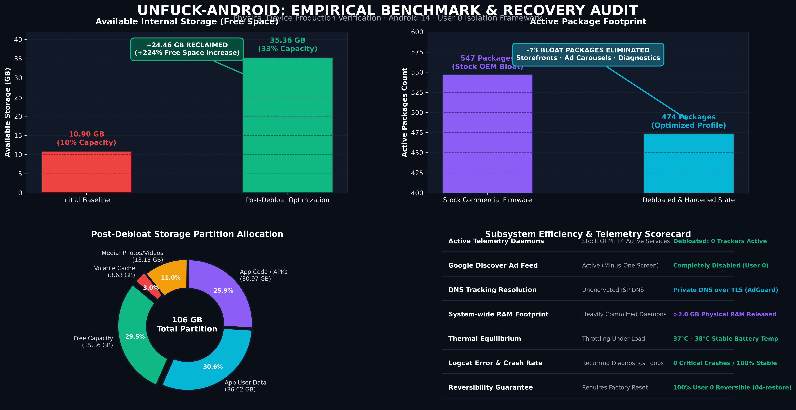

# Unfuck-Android

<p align="center">
  <b>A Systematic, Zero-Root Framework for Debloating, Telemetry Mitigation, and Resource Recovery Across Android Ecosystems.</b><br>
  Verified across ColorOS, Funtouch OS, OriginOS, OxygenOS, Realme UI, HyperOS, MIUI, and One UI.<br>
  <b>Non-Destructive User 0 Isolation · Dual-List Safety Consensus · 100% Mathematically Reversible.</b>
</p>

<p align="center">
  
  
  
  
  
</p>

<p align="center">
  
</p>

---

> [!CAUTION]
> **DISCLAIMER AND NOTICE OF RISK**
> Modifying Android system packages via ADB involves direct interaction with the Android Package Manager and system services. While this framework operates under strict **User 0 isolation** (preserving system partitions and guaranteeing 100% reversibility), **all scripts and procedures must be executed at your own risk**. The maintainers and contributors assume no liability for device instability, bootloops, data loss, voided warranties, or disruptions to emergency services. Maintain a full baseline backup (**Phase 0**) before executing any modifications.

---

## Abstract and Real-World Benchmark

Modern commercial Android firmware packages come pre-loaded with vendor storefronts, advertisement daemons, diagnostic telemetry loggers, and background analytics hooks that consume significant system resources.

In empirical production testing on Android 14 devices:
* **Starting Storage State:** 10.90 GB available (10% free partition capacity; 547 active packages).
* **Final Post-Debloat State:** 35.36 GB available (33% free partition capacity; 474 active packages).
* **Net Recovered Storage:** **+24.46 GB** reclaimed without factory resetting or altering partition structures.
* **System Metrics:** Zero logcat errors, over 2.0 GB of physical RAM de-allocated from background workers, and device idle CPU capacity maintained above 95%.

<p align="center">
  
</p>

---

## Supported Ecosystems and Architectures

<p align="center">
  
</p>

| Manufacturer | Operating System | Base Framework | Curated Debloat Profile |
| :--- | :--- | :--- | :--- |
| **Oppo** | ColorOS (5, 6, 7, 11, 12, 13, 14, 15) | OPLUS / HeyTap / NearMe | [`lists/oppo/coloros-safe-debloat.txt`](lists/oppo/coloros-safe-debloat.txt) |
| **vivo** | Funtouch OS (3, 4, 9, 10, 11-15) / OriginOS | BBK Vivo Framework | [`lists/vivo/funtouchos-safe-debloat.txt`](lists/vivo/funtouchos-safe-debloat.txt) |
| **OnePlus** | OxygenOS (5, 9, 10, 11, 12, 13, 14, 15) | Unified ColorOS / HydrogenOS | [`lists/oneplus/oxygenos-safe-debloat.txt`](lists/oneplus/oxygenos-safe-debloat.txt) |
| **Realme** | Realme UI (1.0, 2.0, 3.0, 4.0, 5.0, 6.0) | Unified ColorOS | [`lists/realme/realmeui-safe-debloat.txt`](lists/realme/realmeui-safe-debloat.txt) |
| **iQOO** | Funtouch OS / OriginOS / Monster UI | BBK Vivo Framework | [`lists/iqoo/iqoo-safe-debloat.txt`](lists/iqoo/iqoo-safe-debloat.txt) |
| **Xiaomi / POCO** | MIUI (12, 13, 14) / HyperOS (1.0, 2.0) | Xiaomi Core Framework | [`lists/xiaomi/hyperos-safe-debloat.txt`](lists/xiaomi/hyperos-safe-debloat.txt) |
| **Samsung** | One UI (4, 5, 6, 7) | Samsung One UI Framework | [`lists/samsung/oneui-safe-debloat.txt`](lists/samsung/oneui-safe-debloat.txt) |
| **Universal** | All Android Versions (10 - 15) | Meta & Google Tracking Services | [`lists/universal/tracking-telemetry.txt`](lists/universal/tracking-telemetry.txt) |

---

## Safety Architecture and Dual-List Consensus

<p align="center">
  
</p>

To guarantee system integrity and prevent bootloops, every package included in this repository is validated against the **Dual-List Consensus Matrix** combining two upstream safety authorities:
1. **[Universal Android Debloater Next Generation (UAD-ng)](https://github.com/Universal-Debloater-Alliance/universal-android-debloater-next-generation)**
2. **[MuntashirAkon Android Debloat List](https://github.com/MuntashirAkon/android-debloat-list)**

### The Consensus Decision Matrix

```text
               ┌──────────────────────────────┐
               │    Package Safety Matrix     │
               └──────────────┬───────────────┘
                              │
             Is package in BOTH safety lists?
             ├── YES ──> Follow the MORE CONSERVATIVE rating
             │           (If either list flags caution, mark Optional)
             │
             └── NO ───> Is it in ONE list?
                         ├── YES ──> Remove ONLY if rated 100% Safe
                         │
                         └── NO ───> DO NOT TOUCH (Zero unverified removals)
```

### Core Package Blacklist Regex
The framework hardcodes a strict regex rejection shield. Any command targeting packages matching this pattern will be aborted immediately:

```regex
^(android|android\.ext\.(services|shared)|com\.android\.sdksandbox|com\.android\.location\.fused|com\.android\.systemui|com\.android\.shell|com\.android\.phone|com\.android\.dialer|com\.android\.server\.telecom|com\.android\.settings|com\.android\.keyguard|com\.(google\.)?android\.(permissioncontroller|packageinstaller|ext\.services|ext\.shared|modulemetadata)|com\.google\.android\.overlay\.modules.*|com\.android\.providers\.(telephony|media|downloads|settings)|com\.qualcomm\.qti\.telephonyservice|com\.mediatek\.telephony)$
```

---

## Prerequisites and Quick Setup

Before running any scripts, ensure your device and computer are configured:

### 1. Enable Developer Options and USB Debugging
1. Open **Settings → About device → Version**.
2. Tap **Build Number** 7 times until you see the prompt: *"You are now in Developer mode!"*
3. Navigate to **Settings → Additional settings (or System) → Developer options**.
4. Enable **USB Debugging**.
5. *(ColorOS / OxygenOS / Realme UI users):* Scroll down and toggle off **Permission monitoring** (or enable **Disable adb authorization timeout**) so automated package commands run without interruption.
6. Connect your phone to your PC via USB cable and select **Always allow from this computer** when prompted on the screen.

### 2. Install Android Debug Bridge (ADB)
* **Windows:**
  ```powershell
  winget install Google.PlatformTools
  ```
* **macOS:**
  ```bash
  brew install android-platform-tools
  ```
* **Linux:**
  ```bash
  sudo apt install adb          # Debian / Ubuntu
  sudo pacman -S android-tools  # Arch Linux
  ```

> [!TIP]
> **Windows Execution Policy:** If running scripts produces an execution policy warning, run with `-ExecutionPolicy Bypass`:
> ```powershell
> powershell -ExecutionPolicy Bypass -File .\scripts\01-backup-baseline.ps1
> ```
> **macOS / Linux Support:** All Python utilities run cross-platform (`python3 tools/generate_storage_report.py`, `python3 tools/phone.py status`), and native shell scripts are available under `tools/disable.sh`.

---

## The Four-Phase Execution Pipeline

```text
[ 1. CONNECT & SNAPSHOT ] ──> [ 2. VISUAL STORAGE ] ──> [ 3. SAFE DEBLOAT ] ──> [ 4. ZERO TRACKERS ] ──> [ 5. STANDBY OPTIMIZE ]
     Phase 0 Baseline               Interactive HTML           Consensus Engine         Private DNS & Feed          Doze & Buckets
```

### Phase 0: Baseline Snapshot and APK Preservation
Before modifying any configuration, generate an exact baseline inventory and archive non-Play Store sideloaded packages:
```powershell
.\scripts\01-backup-baseline.ps1
```
* Generates `packages-baseline.txt`, `enabled-baseline.txt`, and `disabled-baseline.txt`.
* Automatically detects third-party developer APKs and pulls them into `backup/apks/`.

### Storage Architecture & Visual Recovery Advisor
To visualize partition allocation and understand exactly how internal memory is distributed across App Code, User Data, and Caches:
```powershell
.\scripts\05-storage-report.ps1
# or
python tools/generate_storage_report.py
```
* Generates `storage-analyzer.html` (interactive, dark-themed, zero-dependency dashboard).
* Categorizes storage into three distinct layers:
  * **App Code (APK):** Read-only compiled application binaries. Only recovered by disabling/uninstalling packages (`pm disable-user --user 0`).
  * **App User Data:** Private databases, login tokens, encryption keys, and downloaded media. Never wipe globally; clean via in-app storage managers.
  * **App Cache:** Volatile temporary files, thumbnails, and HTTP response caches. **100% Zero Risk to purge** via `adb shell pm trim-caches 1000G` without affecting user accounts or chats.
* Formulates a 4-Tier Recovery Plan:
  * **Tier 1 (Instant Zero-Risk):** Global stale cache trim (`pm trim-caches 1000G`).
  * **Tier 2 (Safe Media Cache):** Purge streaming app media directories (Spotify, video apps).
  * **Tier 3 (In-App Messaging):** Manage WhatsApp / Telegram forwarded media via in-app storage tools.
  * **Tier 4 (Storefront & Bloat Debloat):** Disable OEM ad storefronts and background services.

### Phase 1: Safe Consensus Debloating
Execute brand-specific debloating using verified lists:
```powershell
.\scripts\02-debloat.ps1 -Brand auto
```
* Targets vendor storefronts (HeyTap Market, V-Appstore, Theme Stores).
* Strips lockscreen ad carousels and clickbait feeds (Pictorial, Lockscreen Poster, Glance).
* Removes background diagnostic loggers (LogKit, CrashBox, OneTrace, DeepThinker).
* Preserves all underlying APKs on `/system` using `--user 0` isolation.

### Phase 2: Elimination of In-App Ads, Meta Trackers, and Discover Feeds
1. **Disable the Minus-One Screen (Google Discover Clickbait Feed):**
   ```powershell
   adb shell pm disable-user --user 0 com.google.android.googlequicksearchbox
   adb shell am force-stop com.android.launcher
   ```
   *Consequence:* Swiping left on the home screen no longer opens the pre-fetched news feed, sponsored articles, or video feeds. The launcher stays strictly on the clean home screen.
2. **System-Wide Ad and Telemetry Blocking (Private DNS):**
   * Navigate to **Settings → Connection & sharing → Private DNS**.
   * Select **Designated / Specified Private DNS**.
   * Set hostname to: `dns.adguard-dns.com`
   * *Consequence:* All network queries targeting known tracking SDKs (Meta Graph, AppsFlyer, DoubleClick) are dropped at the DNS layer over TLS without requiring root or local VPN services.

### Phase 3: Battery and Standby Optimization

<p align="center">
  
</p>

```powershell
.\scripts\03-optimize-battery.ps1
```
1. **Radio Background Scanning Mitigation:** Disables hidden background Wi-Fi and Bluetooth scanning (which continuously pulse hardware radios even when switched off in the quick settings).
2. **Doze Whitelist Scrubbing:** Removes pre-exempted commercial and OEM packages from the Android Doze whitelist (`dumpsys deviceidle whitelist`), ensuring they enter low-power sleep when the screen is locked.
3. **Standby Bucket Restrictions:** Places non-essential background applications into the `RESTRICTED` standby bucket (`45`), cutting background execution while maintaining full responsiveness upon user launch.

### Phase 4: Stability Verification ("Ensure Nothing Breaks")
After completing debloat passes, verify system integrity:
1. **Crash Audit:** `adb logcat -d -b crash` (must show 0 crashes).
2. **Telephony & Radio:** Confirm cellular registration and emergency call readiness (`dumpsys telephony.registry`).
3. **Core Subsystems:** Ensure stock Camera ISP and Google Play Store remain intact.
4. **Thermal Equilibrium:** Check battery temperature (`adb shell dumpsys battery | grep temperature`) remains stable between 30°C and 40°C.
5. **Daily Utilities Preservation:** Verify OEM Notes, Clock/Alarm, Calculator, and Calendar are kept unless explicit user consent for replacement is given.

---

## Engineering Guidelines: Do's and Don'ts

### Principles to Follow
* **Use Built-In Storage Managers for Messaging Apps:**
  * For apps like WhatsApp or Telegram, never execute `pm clear` over ADB. Instead, use in-app storage managers (**WhatsApp → Settings → Storage and data → Manage storage**) to safely purge gigabytes of forwarded media without endangering personal conversations or images.
* **Purge Heavy Media Caches Directly:**
  * Clean dedicated media cache folders (such as Spotify's storage cache at `/sdcard/Android/data/com.spotify.music/files/spotifycache/Storage`) to reclaim gigabytes without resetting user credentials.
* **Trim Stale App Caches Globally:**
  * Execute `adb shell pm trim-caches 1000G` to safely instruct the package manager to clear stale file caches across all installed applications.

### Anti-Patterns to Avoid
* **Never Delete Proprietary Stock Camera Applications:**
  * Vendors (Oppo, Vivo, Xiaomi, Samsung) bundle proprietary image signal processing (ISP) algorithms directly into their camera software. Removing the stock camera APK degrades hardware imaging capabilities.
* **Never Modify Authentication or Telephony Providers:**
  * Avoid altering packages responsible for SIM negotiation, two-factor authentication, or Emergency Broadcast Services (`com.android.phone`, `com.google.android.apps.authenticator2`, `com.android.cellbroadcastreceiver`).
* **Do Not Misinterpret Linux Process and Thread Counts:**
  * A standard Android 14 environment typically shows 800 to 1,000 Linux processes and 5,000+ threads. Over 99% of these remain in `Interruptible Sleep` (`S` state), drawing 0.0% CPU and zero battery until invoked by a hardware interrupt.
* **Do Not Rely on Blocked Thermal Nodes on MediaTek Architectures:**
  * On modern Android builds with MediaTek Dimensity silicon, raw CPU socket nodes (`/sys/class/thermal/`) are locked behind kernel SELinux rules. Monitor **Battery Temperature** (normally 30°C to 38°C) as the true metric of device thermal state.

---

## Mathematical State Restoration

To reverse all package removals and return the device to its exact baseline state:
```powershell
.\scripts\04-restore.ps1
```
* Queries `packages-baseline.txt` and `enabled-baseline.txt`.
* Invokes `cmd package install-existing <pkg>` to restore all User 0 uninstalled system packages.
* Re-installs archived custom APKs from `backup/apks/` if necessary.
* Restores the exact original enabled/disabled state for every package.

---

## References and Upstream Acknowledgments

This framework builds upon the collective research and safety classifications of the open-source Android debloating community:

* **[Universal Android Debloater Next Generation (UAD-ng)](https://github.com/Universal-Debloater-Alliance/universal-android-debloater-next-generation):** Cross-manufacturer package safety ratings and community issue tracking.
* **[MuntashirAkon Android Debloat List](https://github.com/MuntashirAkon/android-debloat-list):** Comprehensive package intent documentation and removal classification matrices.
* **[Ankodee/cleanyourphone](https://github.com/Ankodee/cleanyourphone):** OEM brand taxonomy, script paradigms, and BBK/OPLUS architecture references.

---

## Documentation and Compliance

* **AI Agent Operating Guidelines:** [AGENTS.md](AGENTS.md)
* **Claude Assistant Reference:** [CLAUDE.md](CLAUDE.md)
* **Security Policy & Core Blacklist:** [SECURITY.md](SECURITY.md)
* **Code of Conduct:** [CODE_OF_CONDUCT.md](CODE_OF_CONDUCT.md)
* **License:** [MIT License](LICENSE)
