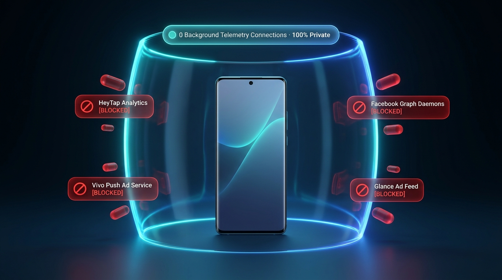

# Telemetry & Privacy Analysis

  

Why debloat your Android smartphone?
Modern OEM firmware (ColorOS, OxygenOS, Realme UI, Funtouch OS, OriginOS) includes complex
telemetry frameworks that continuously collect user telemetry and push advertisements.

---

## The Top Telemetry Vectors

### 1. Lock Screen Magazines (Glance, Pictorial, Poster)
- **Packages:** `com.heytap.pictorial`, `com.glance.internet`, `com.vivo.magazine`
- **Behavior:**
  - Wakes up the mobile radio periodically to fetch clickbait news articles, shopping deals, and sponsored wallpapers.
  - Sends lock screen unlock counts, dwell time, and interaction metrics back to content delivery networks.

### 2. Proprietary Push Notification Daemons (MCS & Vivo Push)
- **Packages:** `com.heytap.mcs`, `com.vivo.pushservice`
- **Behavior:**
  - Distinct from Google Firebase Cloud Messaging (FCM).
  - Maintained specifically by OEM subsidiaries (HeyTap, BBK) to deliver promotional banners for theme sales, app store trending apps, and game downloads.

### 3. OpenID / OAID Hardware Identifiers
- **Packages:** `com.heytap.openid`, `com.vivo.agent`
- **Behavior:**
  - Generates cross-app tracking identifiers (OAID) designed to bypass Android's privacy restrictions on MAC addresses and IMEIs, allowing ad networks to track user identity across third-party apps.

### 4. Background Diagnostic & Habit Engines
- **Packages:** `com.oplus.deepthinker`, `com.coloros.atd`, `com.vivo.daemonService`
- **Behavior:**
  - Logs app launch sequences, Wi-Fi SSID connections, location history, and device usage cycles to "predict user behavior", generating gigabytes of diagnostic logs.

---

## Result of Debloating

Disabling these packages completely silences these background connections. Combined with
a Private DNS provider (such as NextDNS or AdGuard DNS), your device's background network
footprint drops to near zero during standby.
